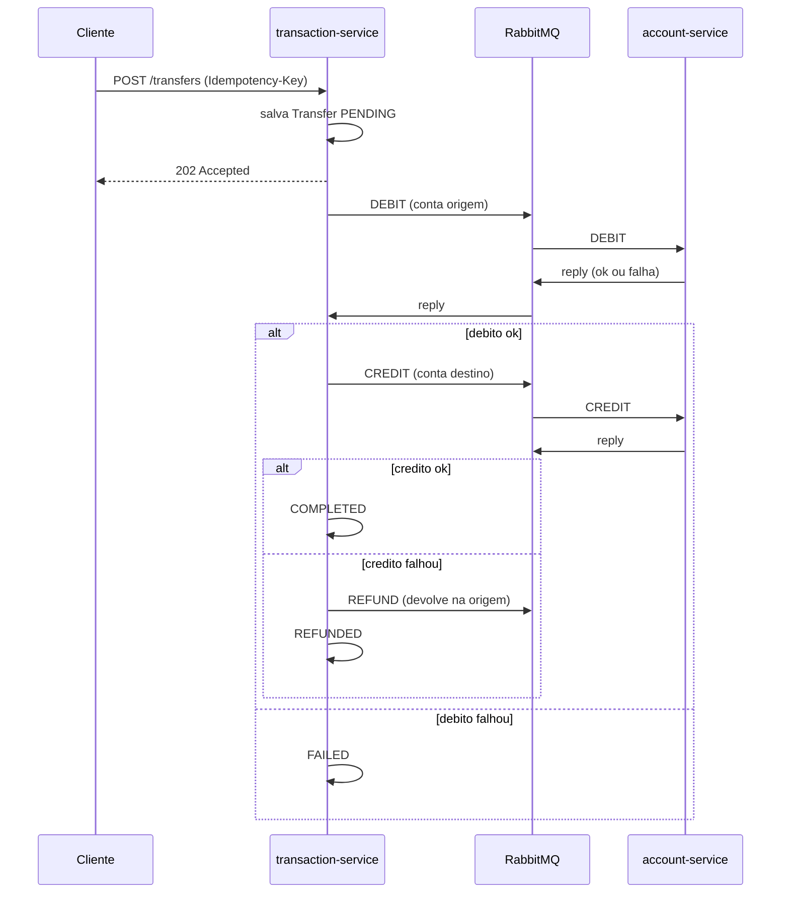

# Carteira / Pagamentos com fila

Projeto de estudo: uma carteira digital com dois servicos que conversam por fila (RabbitMQ).
Foco em tres assuntos que aparecem muito em sistemas de pagamento: **mensageria**, **idempotencia** e **saga**.

Stack: Java 17, Spring Boot 3.5, Spring AMQP (RabbitMQ), Spring Data JPA, PostgreSQL, Flyway, Testcontainers, Docker Compose.

## Como funciona

| Servico | Porta | Responsabilidade |
|---|---|---|
| `account-service` | 8081 | Contas, saldo, extrato. Consome comandos de debito/credito/estorno. |
| `transaction-service` | 8082 | API de transferencias e orquestrador da saga. |
| `contracts` | - | Mensagens e topologia do RabbitMQ compartilhadas. |

Cada servico tem o proprio banco (`accounts` e `transactions`). Eles so se falam pela fila.



### Saga (orquestrada)

O `transaction-service` guarda o estado da transferencia e decide o proximo passo a cada resposta:

```
PENDING -> DEBITED -> COMPLETED
PENDING -> FAILED                      (saldo insuficiente, conta inexistente)
DEBITED -> COMPENSATING -> REFUNDED    (credito falhou, valor volta para a origem)
COMPENSATING -> COMPENSATION_FAILED    (estorno falhou, precisa de acao manual)
```

O passo de compensacao e o `REFUND`: se o dinheiro ja saiu da origem e o destino nao pode receber, o valor e devolvido.

### Idempotencia (em tres lugares)

1. **API**: `POST /transfers` exige o header `Idempotency-Key`. A chave tem `UNIQUE` no banco.
   Mesma chave e mesmos dados devolve a mesma transferencia (200 em vez de 202). Mesma chave com dados diferentes devolve 409.
   Requisicoes simultaneas com a mesma chave tambem criam uma transferencia so (a constraint barra as outras).
2. **Consumidor de comandos**: o `account-service` grava cada comando tratado na tabela `processed_commands`
   (`UNIQUE(transfer_id, command_type)`) junto com o resultado. Se a mesma mensagem chegar de novo, devolve a resposta guardada
   sem mexer no saldo. O resultado de falhas tambem e guardado: sem isso, um redelivery depois de o saldo mudar poderia
   transformar uma recusa em sucesso.
3. **Orquestrador**: cada resposta so avanca a saga se a transferencia estiver no estado esperado. Resposta duplicada ou atrasada e ignorada.

### Falhas e retry

- Mensagens que dao erro sao reprocessadas 4 vezes (backoff exponencial) e depois vao para a fila `*.dlq`.
- Comandos so sao publicados **depois do commit** do banco (`@TransactionalEventListener(AFTER_COMMIT)`).
- Se o commit deu certo mas o broker estava fora do ar, a transferencia fica parada. O `StuckTransferRetrier`
  (job agendado) reenvia o comando de transferencias paradas ha mais de 60s. Reenviar e seguro por causa da idempotencia.

## Rodando

Precisa de Java 17, Maven e Docker.

```bash
docker compose up --build -d
./scripts/smoke-test.sh      # teste ponta a ponta com curl
```

Painel do RabbitMQ: http://localhost:15672 (guest/guest).

### Exemplo

```bash
# cria duas contas
curl -X POST localhost:8081/accounts -H 'Content-Type: application/json' \
  -d '{"ownerName":"Alice","initialBalance":100.00}'
curl -X POST localhost:8081/accounts -H 'Content-Type: application/json' \
  -d '{"ownerName":"Bob","initialBalance":0}'

# transfere 40 da Alice para o Bob
curl -X POST localhost:8082/transfers -H 'Content-Type: application/json' \
  -H 'Idempotency-Key: pedido-123' \
  -d '{"fromAccountId":"<id-alice>","toAccountId":"<id-bob>","amount":40.00}'

# acompanha o status
curl localhost:8082/transfers/<id-da-transferencia>
```

### Metricas das transferencias

O `transaction-service` expoe tres metricas em `/actuator/metrics`:

| Metrica | O que mostra |
|---|---|
| `wallet.transfers.created` | Quantas transferencias foram aceitas (reenvio com a mesma `Idempotency-Key` nao conta de novo) |
| `wallet.transfers.finished` (tag `status`) | Quantas terminaram, por estado final: `COMPLETED`, `FAILED`, `REFUNDED` ou `COMPENSATION_FAILED` |
| `wallet.transfers.in.progress` | Quantas ainda estao no meio da saga (`PENDING`, `DEBITED` ou `COMPENSATING`) |

```bash
curl localhost:8082/actuator/metrics                                  # lista todas
curl localhost:8082/actuator/metrics/wallet.transfers.created
curl "localhost:8082/actuator/metrics/wallet.transfers.finished?tag=status:COMPLETED"
curl localhost:8082/actuator/metrics/wallet.transfers.in.progress
```

Uma transferencia que fica muito tempo em andamento e sinal de problema (broker fora do ar, por exemplo). O contador so sobe depois do commit no banco, para uma mensagem reprocessada nao contar duas vezes.

### Mensagens com erro (DLQ)

Mensagem que nao da para processar (JSON invalido, campos faltando) nao fica em loop: depois de 4 tentativas vai para a fila `account.commands.dlq`. `GET localhost:8081/admin/dead-letters` mostra quantas estao paradas la. O que cair na DLQ precisa de alguem para olhar, nao ha reprocessamento automatico.

### Endpoints

| Metodo | Rota | Servico |
|---|---|---|
| POST | `/accounts` | account |
| GET | `/accounts/{id}` | account |
| GET | `/accounts/{id}/ledger?page=&size=` | account (extrato paginado, mais recente primeiro, `size` de 1 a 100) |
| GET | `/admin/dead-letters` | account (mensagens paradas na DLQ) |
| POST | `/transfers` (header `Idempotency-Key`) | transaction |
| GET | `/transfers/{id}` | transaction |
| GET | `/actuator/health` | ambos |

## Testes

```bash
mvn verify
```

Os testes de integracao usam Testcontainers (Postgres e RabbitMQ reais), entao o Docker precisa estar rodando. 65 testes:

- **Unitarios**: regras da conta (saldo, valores invalidos) e transicoes de estado da saga.
- **Idempotencia**: mesmo comando processado duas vezes mexe no saldo uma vez; falha continua falha no redelivery;
  mesma `Idempotency-Key` em 8 threads cria uma transferencia so; mensagem duplicada pelo broker debita uma vez.
- **Saga pelo broker**: fluxo feliz, debito recusado, credito recusado com estorno, estorno recusado.
- **Retry**: o job reenvia o comando de uma transferencia parada e ignora as recentes e as finalizadas.
- **API**: validacoes, header obrigatorio, 202/200/400/404/409/422.

## Glossario

- **Saga**: uma operacao que passa por mais de um servico e nao cabe numa unica transacao de banco. Aqui, transferir dinheiro e debitar na conta de origem (servico de contas) e depois creditar na de destino. Se um passo falha, os anteriores sao desfeitos por passos de volta.
- **Compensacao**: o passo que desfaz um passo anterior que ja foi confirmado. Aqui e o `REFUND`: se o debito deu certo mas o credito falhou, o valor volta para a conta de origem.
- **Idempotencia**: fazer a mesma operacao varias vezes tem o mesmo efeito de fazer uma vez. Sem isso, um reenvio (cliente que repete a requisicao, broker que entrega a mensagem duas vezes) debitaria duas vezes.
- **Idempotency-Key**: o identificador que o cliente manda junto da requisicao para a API reconhecer que e a mesma operacao.
- **Orquestracao**: um servico (o de transacoes) decide qual e o proximo passo da saga a cada resposta. A alternativa e a coreografia, em que cada servico reage aos eventos dos outros.
- **Dead letter queue (DLQ)**: fila para onde vao as mensagens que falharam em todas as tentativas, para nao ficarem em loop e para alguem investigar.
- **Retry com backoff**: tentar de novo esperando mais a cada tentativa (aqui 0,5s, 1s, 2s).
- **Commit antes de publicar**: so mandar a mensagem para a fila depois de a transacao do banco ter dado commit, para nunca avisar de algo que nao foi gravado.

## Limitacoes conhecidas (o que eu faria a seguir)

- **Outbox**: hoje o comando e publicado depois do commit e o retrier cobre a falha. O padrao Transactional Outbox seria mais robusto.
- **Sem autenticacao**: as APIs sao abertas, o foco foi a mensageria.
- **Sem deposito/saque**: o saldo inicial e definido na criacao da conta.
- **DLQ**: mensagens que vao para a DLQ precisam ser inspecionadas manualmente, nao ha reprocessamento automatico.
- **Estorno falho** (`COMPENSATION_FAILED`) so e logado e marcado; faltaria um alerta.
